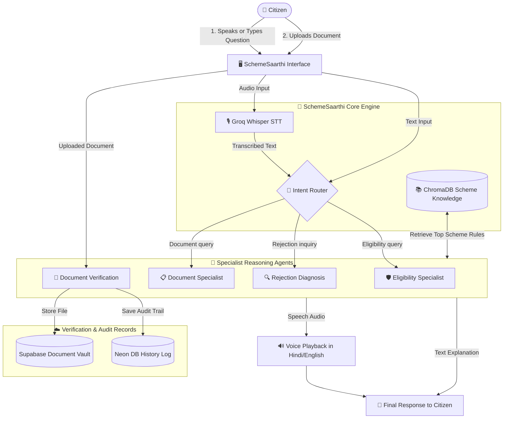

# 🏛️ SchemeSaarthi (स्कीम सारथी)
> **An Agentic AI Personal Assistant Bridging the "Reality Gap" in Indian Government Scheme Access.**

---

## 📌 What is SchemeSaarthi?

**SchemeSaarthi** is an AI-powered personal assistant built specifically to solve the massive disconnect between government welfare policies and actual citizen access in India.

While central and state governments announce thousands of welfare schemes offering financial aid, healthcare, housing, and social security, millions of eligible citizens fail to benefit from them due to what is known as the **"Reality Gap"**. 

SchemeSaarthi bridges this gap using a **Multi-Agent Architecture** and **Voice-First AI** that speaks the citizen's language (Hindi & English), verifies eligibility strictly against complex rules, validates uploaded official documents, and explains *why* an application might get rejected before it is submitted.

---

## ⚠️ The Problem: The "Reality Gap" in Welfare Access

Eligible beneficiaries in India face 4 major bottlenecks:

1. **The Bureaucracy Trap:** Guidelines are buried inside 50+ page legal and administrative PDFs that ordinary citizens cannot decipher.
2. **Hidden Exclusion Criteria:** Subtle restrictions (income ceiling, caste categories, land size, existing vehicle ownership) silently disqualify applicants.
3. **Document Discrepancies:** Applications fail due to minor document mistakes (expired income certificates, missing seals, or incorrect proofs).
4. **Opaque Rejections:** When an application is rejected, citizens rarely receive an explanation or advice on how to rectify the issue.

```
❌ Traditional Citizen Journey:
[Vague Circular] ➡️ [Unclear Requirements] ➡️ [Submits Flawed Application] ➡️ [Silent Rejection]

✅ With SchemeSaarthi:
[Voice / Text Query in Hindi or English]
       ⬇️
[Eligibility Specialist Agent]   ➡️ Checks exact qualifications & points out missing details
       ⬇️
[Document Verification Agent]     ➡️ Scans & validates certificates before submission
       ⬇️
[Rejection Diagnosis Agent]       ➡️ Catches exclusion rules & prescribes fixes
       ⬇️
[Confident Citizen with Clear Step-by-Step Roadmap]
```

---

## 🤖 The Specialized AI Agents

Instead of using a generic chatbot, SchemeSaarthi deploys a team of **specialized AI agents**, each dedicated to a critical phase of the application journey:

### 1. 🛡️ Eligibility Reasoning Agent
* Evaluates applicant details against official scheme parameters.
* Actively detects and prompts for missing criteria (e.g., household income, landholding, caste category, domicile status).
* Strict and transparent: explains the exact rule used to determine eligibility.

### 2. 📋 Document Readiness Agent
* Generates structured, categorized checklists:
  - Identity Proofs (Aadhaar, Voter ID)
  - Income & Domicile Certificates
  - Land & Property Records
  - Bank Account & IFSC requirements
* Highlights time-sensitive conditions (e.g., *"Income certificate must be issued within the last 6 months"*).

### 3. 🔍 Rejection Diagnosis Agent *(Novel Reality-Gap Resolver)*
* Specifically handles queries regarding past application failures or potential roadblocks.
* Parses fine-print exclusion criteria to explain *why* an application failed or could fail.
* Empathic and actionable: provides remedial guidance to fix the application rather than just giving a rejection notice.

### 4. 📄 Document Verification Agent
* Analyzes user-uploaded documents (PDFs and images of Aadhaar, Income certificates, Caste certificates).
* Extracts document content and validates it against the specific scheme's prerequisite criteria.
* Looks for red flags (expired dates, missing seals, name inconsistencies).
* Issues clear verdicts: `VALID`, `INVALID`, or `NEEDS_REVIEW` with an explanation.

### 5. 💬 General Knowledge & Guidance Agent
* Handles scheme overviews, objective summaries, departmental contact numbers, and general welfare queries.

---

## 🌟 Core Capabilities

### 🎙️ 1. Voice-First & Bilingual (Hindi + English)
Citizens can ask questions naturally by speaking through a microphone. SchemeSaarthi transcribes the speech using **Groq Whisper** (`whisper-large-v3-turbo`) and can read out the final response in clear Hindi or English audio using **gTTS**, making it accessible to non-literate and rural citizens.

### 📑 2. Pre-Submission Document Verification
Users can upload their application documents directly. SchemeSaarthi reads the file, confirms whether it matches the scheme requirements, stores the document securely in **Supabase Storage**, and records an audit log of the verification in **Neon PostgreSQL**.

### ⚡ 3. Ultra-Fast Reasoning with Groq Llama 3.3 70B
All reasoning agents run on **Llama 3.3 70B Versatile** via the **Groq LPU Inference Engine**, providing near-instantaneous contextual answers even on complex eligibility guidelines.

### 📚 4. Verified Ground-Truth Knowledge Base (RAG)
SchemeSaarthi relies on a **ChromaDB** vector database embedded with HuggingFace embeddings (`all-MiniLM-L6-v2`), indexed with real data crawled from **myScheme** (`myscheme.gov.in`) and official government policy notifications.

---

## 📋 Schemes Covered

SchemeSaarthi includes knowledge for both central welfare schemes and state-specific programs (with deep coverage of Maharashtra State schemes), including:

| Scheme Name | Beneficiary Focus | Core Benefits |
| :--- | :--- | :--- |
| **Pradhan Mantri Awas Yojana (PMAY / PMAY-G)** | Homeless, EWS, LIG families | Subsidies & financial aid for permanent housing |
| **Mukhyamantri Majhi Ladki Bahin Yojana** | Women (Ages 21–65) | Monthly direct financial assistance |
| **Mahatma Jyotirao Phule Jan Arogya Yojana** | Low-income households | Cashless health insurance & hospitalization |
| **Homes for Intellectually Impaired Persons (HIIP)** | Mentally deficient / orphan children | Free shelter, healthcare, food & care |
| **Indira Gandhi National Widow Pension Scheme** | Widows below poverty line | Monthly social security pension |
| **Maharashtra Swadhar Yojana** | SC/Navbuddha students | Financial aid for student accommodation & food |
| **Vocational Training Support Schemes** | Underprivileged youth | Subsidized skill training & employment aid |

---

## 🔄 How SchemeSaarthi Processes a Request



---

## 🛠️ Technology Behind SchemeSaarthi

* **Language Model & Intelligence:** Meta Llama 3.3 70B Versatile (via Groq Cloud)
* **Speech-to-Text (STT):** Groq Whisper Large v3 Turbo (Multilingual)
* **Text-to-Speech (TTS):** Google Text-to-Speech (`gTTS`)
* **Agent Framework & RAG:** LangChain, LangChain-Groq, LangChain-Chroma
* **Vector Database:** ChromaDB with HuggingFace `all-MiniLM-L6-v2` embeddings
* **Backend Engine:** FastAPI & Uvicorn
* **Frontend Portal:** Streamlit with embedded audio recorder
* **Cloud Storage & Relational DB:** Supabase Storage (Document Bucket) & Neon PostgreSQL (Verification History)
* **Document Parsing:** PyPDF2

---

<p align="center">
  <b>SchemeSaarthi</b> — Empowering every citizen with clear, actionable access to government welfare. 🇮🇳
</p>
